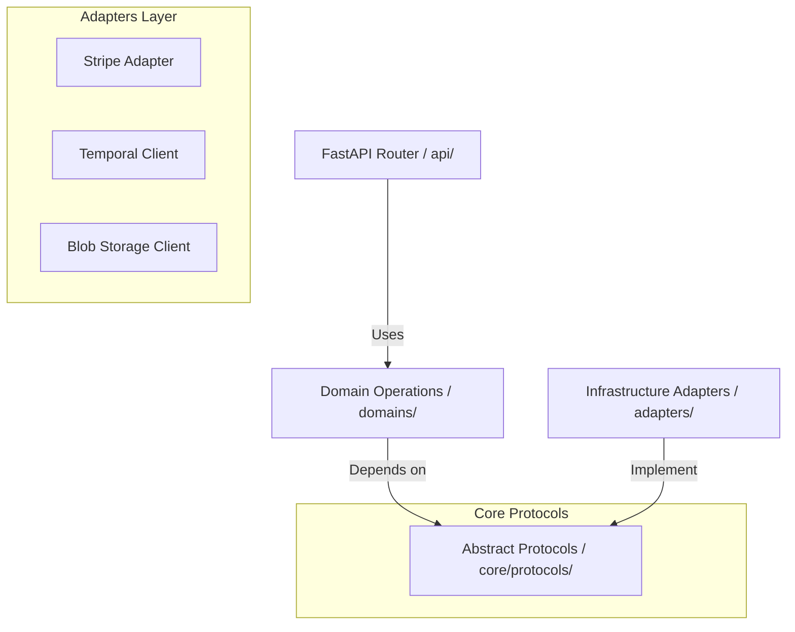
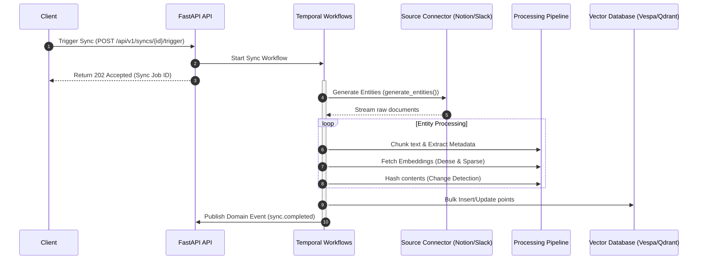

# Connector Context Backend

> Make any app searchable - Universal search and agent integration engine.

**Connector Context Backend** is a high-performance, clean-architecture search and synchronization engine designed to connect external productivity data sources (e.g., Notion, Slack, GitHub) to modern vector databases (Qdrant, Vespa) and LLM contexts.

---

## 🏗️ Architecture & Data Flow

The codebase is built on **Clean Architecture / Domain-Driven Design (DDD)** principles to separate business logic from technical infrastructure details.

### Domain-to-Adapter Interface Boundary

Instead of importing external services directly (e.g., Stripe, Temporal, Svix), all domains communicate via abstract Python `Protocols` defined in `core/protocols/`. Infrastructure implementations reside in `adapters/` and implement these protocols.



### Async Ingestion & Sync Pipeline

Data synchronizations run asynchronously via **Temporal Workflows** which orchestrate the ingestion, chunking, embedding, and indexing phases.



---

## 📁 Directory Structure

```
backend/
├── alembic/                       # Alembic migrations directory
├── connector_context/             # Primary application package
│   ├── api/                       # API routing and middleware
│   │   ├── deps.py                # FastAPI dependencies (wiring DI container)
│   │   ├── middleware.py          # CORS, rate limiting, request validation, timeouts
│   │   └── v1/                    # API v1 routes
│   ├── core/                      # Global cross-cutting infrastructure
│   │   ├── config/                # Settings parsing and validation enums
│   │   ├── container/             # Dependency Injection container registry
│   │   ├── events/                # Event definitions (SyncLifecycleEvent, etc.)
│   │   └── protocols/             # Central contracts (messaging, storage, embeddings)
│   ├── db/                        # Database schemas and repositories
│   │   ├── models/                # SQLAlchemy database models
│   │   └── repositories/          # Repository classes for DB queries
│   ├── domains/                   # Pure business logic (decoupled from infra)
│   │   ├── source_connections/    # Source connections management & OAuth logic
│   │   ├── sync/                  # Sync engines, chunkers, and pipelines
│   │   ├── billing/               # Plan comparisons, usage caps, and gateways
│   │   ├── search/                # Search expanders, rerankers, and retrieval
│   │   └── webhooks/              # Event bus webhook handlers
│   ├── adapters/                  # Infrastructure implementations (implementing core protocols)
│   │   ├── temporal/              # Temporal workers, workflows, and activities
│   │   ├── stripe/                # Stripe billing and subscription client
│   │   ├── storage/               # Local filesystem, S3, or Azure storage clients
│   │   └── svix/                  # Svix event publishing client
│   └── platform/                  # Connector components
│       ├── sources/               # Source connectors (Notion, Slack, Github)
│       └── destinations/          # Vector storage endpoints (Qdrant, Vespa)
└── tests/                         # Root tests folder for cross-domain E2E flows
```

---

## ⚙️ Environment Configuration

Copy `.env.example` to `.env` and fill out the values. Important configurations include:

### Database & Redis Setup

* `POSTGRES_HOST`: Host address of the PostgreSQL server.
* `POSTGRES_USER`: PostgreSQL user name.
* `POSTGRES_PASSWORD`: Password for your PostgreSQL user.
* `POSTGRES_DB`: Name of the database (default: `connector_context`).
* `REDIS_HOST` / `REDIS_PORT`: Local or cloud Redis settings for pub/sub operations.

### Core Embedding Pipeline (Required)

* `DENSE_EMBEDDER`: Dense embedding model registry path (e.g., `openai:text-embedding-3-small`).
* `SPARSE_EMBEDDER`: Sparse embedding model registry path (e.g., `cohere:embed-english-v3.0`).
* `EMBEDDING_DIMENSIONS`: Dimensions matching dense embedder (e.g., `1536`).

### External APIs & LLM Providers

* `OPENAI_API_KEY`: Key for OpenAI inference.
* `ANTHROPIC_API_KEY`: Key for Anthropic Claude inference.
* `GEMINI_API_KEY`: Key for Google Gemini.
* `MISTRAL_API_KEY`: Key for Mistral AI models.
* `COHERE_API_KEY`: Key for Cohere embedding or reranking.
* `GROQ_API_KEY` / `TOGETHER_API_KEY` / `CEREBRAS_API_KEY`: Inference engines.

### Storage Options

* `STORAGE_BACKEND`: Storage option to use (`filesystem` | `azure` | `aws` | `gcp`).
* `STORAGE_PATH`: Local folder for uploaded raw binaries (default: `./local_storage`).
* `STORAGE_AZURE_ACCOUNT` / `STORAGE_AWS_BUCKET` / `STORAGE_GCP_BUCKET`: Credentials for cloud storage.

### Temporal Configuration

* `TEMPORAL_HOST` / `TEMPORAL_PORT`: Temporal instance connection endpoints (default: `localhost:7233`).
* `TEMPORAL_NAMESPACE`: Deployment namespace (default: `default`).
* `TEMPORAL_TASK_QUEUE`: Queue workers listen to (default: `connector-context-sync-queue`).

---

## 🚀 Setting Up Locally

### 1. Install Dependencies

Run [Poetry](https://python-poetry.org/) to install all dependency packages:

```bash
poetry install
```

### 2. Start Infrastructural Services

Spin up local docker instances containing PostgreSQL, Temporal, Qdrant, Vespa, and Redis:

```bash
docker-compose up -d
```

### 3. Run Database Migrations

Apply Alembic migrations to set up local database structures:

```bash
poetry run alembic upgrade head
```

### 4. Run the FastAPI Development Server

Start the server locally using Uvicorn:

```bash
poetry run uvicorn connector_context.main:app --reload --port 8000
```

Interactive API docs are served at [http://localhost:8000/docs](http://localhost:8000/docs).

### 5. Run the Temporal Worker

Run the Temporal client worker to process sync tasks:

```bash
poetry run python -m connector_context.adapters.temporal.worker
```

---

## 🧪 Testing & Validation

Tests are colocated directly within the domains and adapters they test. There is also a root `tests/` directory for integration runs.

### Test Suites

- **Unit Tests:** Run local standalone functions using fakes and mocks.
- **Integration Tests:** Verify DB adapters, schemas, and API routers.
- **Live Integration Tests:** Verify connections to live cloud APIs (marked with `@pytest.mark.live_integration`).

Run all unit and integration tests:

```bash
poetry run pytest -m "not live_integration"
```

### Quality Assurance (Lint & Type Checks)

Run Ruff, Black, and Mypy checks to conform to code quality guidelines:

```bash
# Check style & run quick fixes
poetry run ruff check . --fix

# Check formatting
poetry run black --check .

# Static type verification
poetry run mypy .
```

---

## 🛠️ Troubleshooting

### Database Schema Mismatch

If you get database initialization errors during start-up:

```bash
poetry run alembic downgrade base
poetry run alembic upgrade head
```

### Temporal Task Queue Failures

Ensure your local Temporal server is running and accessible:

```bash
# Verify connection
curl http://localhost:7233
```

If workflows get stuck, verify the Temporal Worker process is active.

> Make any app searchable - Universal search and agent integration engine.

**Connector Context Backend** is a high-performance Python search and data synchronization engine designed to connect external productivity data sources (like Notion, Slack, and GitHub) to modern vector databases (such as Qdrant and Vespa) and LLM applications. 

It provides the necessary pipelines to ingest, clean, chunk, embed, and index content asynchronously using reliable Temporal-based background workers.

---

## Key Features

- 🚀 **FastAPI Engine:** Fully asynchronous HTTP service with request logging, validation, timeout, rate-limiting, and error-handling middlewares.
- 🔄 **Temporal Workflows:** Industrial-grade asynchronous task queues and workflow orchestrations to execute, cancel, and schedule complex sync runs.
- 🔌 **Extensible Sources & Destinations:**
  - **Sources:** Notion, Slack, GitHub, local files, and more.
  - **Destinations:** Vespa, Qdrant, and standard relational stores.
- 🧠 **Dynamic Embedder Framework:** Supports OpenAI, Mistral, Anthropic, Cohere, Cerebras, Together, Groq, and local FastEmbed embeddings.
- ⚡ **Domain-Driven Architecture:** Clean segregation of business domains (`domains/`) from infrastructural details (`adapters/`) using abstract Protocols (`core/protocols/`).
- 📢 **In-Process Event Bus:** Decoupled event publishing and subscribing to handle side effects like webhooks (via Svix) and analytics (via PostHog) cleanly.

---

## Architecture Overview

The backend is structured according to **Clean Architecture** patterns to enforce testability and separation of concerns:

```
backend/connector_context/
├── api/                  # HTTP Layer - thin routing, middleware, and API dependencies
├── core/                 # Cross-cutting concerns (Config, Container DI, Protocols, Events)
├── domains/              # Core Business Logic (source_connections, sync, billing, search, webhooks)
│   └── */operations.py   # Domain operations
│   └── */tests/          # Colocated unit and integration tests
├── adapters/             # Infrastructure Adapters (Temporal, Stripe, Redis, Storage)
├── platform/             # Source/Destination/Embedder implementations
└── db/                   # Database Layer (SQLAlchemy models, Alembic migrations, Repositories)
```

For a comprehensive explanation of the backend redesign, see [connector_context/architecture-refactor.md](file:///d:/Personal/Projects/backend/connector_context/architecture-refactor.md).

---

## Tech Stack & Dependencies

- **Runtime:** Python 3.13+
- **Framework:** FastAPI
- **Database ORM:** SQLAlchemy (Asyncio) with PostgreSQL (`asyncpg`)
- **Task Queue:** Temporal Engine (`temporalio`)
- **Package Manager:** Poetry
- **Linter & Formatter:** Ruff, Black, and isort

---

## Local Development Setup

### 1. Prerequisites

Make sure you have the following installed on your machine:
- Python 3.13+
- Poetry
- Docker & Docker Compose (for running PostgreSQL, Temporal, Qdrant, and Redis locally)

### 2. Installation

Clone the repository and install the dependencies using Poetry:

```bash
# Navigate to the backend directory
cd backend

# Install project dependencies
poetry install
```

### 3. Environment Configuration

Copy the example environment file and configure the values to match your local setup:

```bash
cp .env.example .env
```

### 4. Running Database Migrations

Apply Alembic migrations to set up your database schema:

```bash
poetry run alembic upgrade head
```

### 5. Running the Application

Start the FastAPI application in development mode:

```bash
poetry run uvicorn connector_context.main:app --reload --port 8000
```

The interactive API documentation will be available at [http://localhost:8000/docs](http://localhost:8000/docs).

---

## Testing

The project uses `pytest` for testing. Tests are colocated within their respective domains and adapters under `tests/` directories.

To run the full test suite:

```bash
poetry run pytest
```

To run a specific test suite or domain tests:

```bash
poetry run pytest connector_context/domains/source_connections/tests/
```

We also run type-checking (`mypy`) and linting (`ruff`):

```bash
# Lint check
poetry run ruff check .

# Code formatting check
poetry run black --check .

# Type checking
poetry run mypy .
```

---

## License

This project is proprietary and confidential. All rights reserved.
